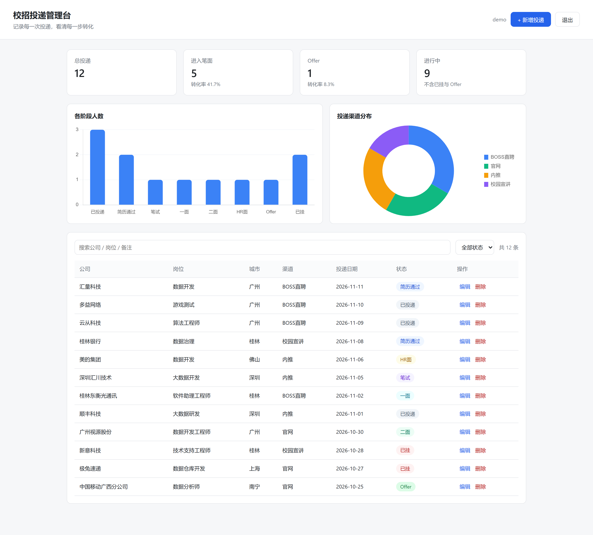

# 校招投递管理台

一个自用的校招投递记录工具：记录每一次投递的公司、岗位、渠道与进度，用看板看清投递量、面试转化率和渠道效果。



> 截图为演示数据。12 条记录、4 个投递渠道，展示看板、图表与列表的完整形态。

## 功能

- **账号登录**：首次启动可注册一个账号，之后注册入口自动关闭；会话 7 天有效
- **投递记录管理**：新增 / 编辑 / 删除，支持公司、岗位、城市、渠道、薪资、投递日期、状态、JD 链接、备注
- **进度追踪**：状态从「已投递 → 简历通过 → 笔试 → 一面 → 二面 → HR面 → Offer / 已挂」
- **数据看板**：总投递量、进入笔面人数、Offer 数、进行中数量；各阶段人数柱状图、渠道分布环形图
- **快速检索**：按公司 / 岗位 / 备注关键词搜索，按状态筛选
- **分页**：默认每页 20 条，上限 100 条，页码越界自动回退

## 技术栈

| 层次 | 选型 | 说明 |
|---|---|---|
| 后端 | Flask 3 | 10 个接口（含鉴权）+ 页面路由 |
| 数据库 | SQLite | 标准库 `sqlite3`，无需额外服务，开箱即用 |
| 前端 | 原生 JS + Chart.js | 无构建步骤，直接由 Flask 托管 |
| 鉴权 | Session Cookie | 密码 `werkzeug` 哈希存储，接口守卫区分 401 与页面跳转 |
| 测试 | pytest | 27 个用例覆盖鉴权、CRUD、分页、校验、统计 |

## 快速开始

### 日常使用（推荐）

双击 `start.bat`，或在命令行执行：

```bash
python run.py
```

浏览器会自动打开 http://127.0.0.1:5000 ，首次会进入注册页，创建账号后自动登录。关闭窗口即停止服务。

### 开发调试

```bash
python app.py     # 带热重载，改代码自动重启
```

### 首次安装

```bash
python -m venv .venv
# Windows
.venv\Scripts\activate
# macOS / Linux
source .venv/bin/activate

pip install -r requirements.txt
```

数据库文件 `data/job_tracker.db` 首次启动时自动创建。

## 环境变量

| 变量 | 默认值 | 说明 |
|---|---|---|
| `SECRET_KEY` | `dev-secret-change-me` | 会话签名密钥，**部署到公网前必须改** |
| `APP_TIMEZONE` | `Asia/Shanghai` | 时间戳与「近 30 天」统计使用的时区 |

## 接口一览

| 方法 | 路径 | 鉴权 | 说明 |
|---|---|---|---|
| GET | `/login` | — | 登录页 |
| GET | `/api/auth/status` | — | 是否已初始化、是否已登录 |
| POST | `/api/auth/register` | — | 首次注册（已有账号时返回 403） |
| POST | `/api/auth/login` | — | 登录 |
| POST | `/api/auth/logout` | — | 退出登录 |
| GET | `/api/applications?page=&page_size=&keyword=&status=` | 需要 | 分页列表 |
| POST | `/api/applications` | 需要 | 新增投递记录 |
| PUT | `/api/applications/<id>` | 需要 | 更新记录（支持部分字段） |
| DELETE | `/api/applications/<id>` | 需要 | 删除记录 |
| GET | `/api/stats` | 需要 | 看板统计：各状态人数、渠道分布、近 30 天趋势、转化率 |

列表返回结构：

```json
{ "items": [], "total": 0, "page": 1, "page_size": 20, "pages": 0 }
```

## 运行测试

```bash
pytest              # 27 passed
pytest -v           # 查看每个用例
```

测试使用 `tmp_path` 下的独立数据库，不会碰本地 `data/job_tracker.db`。

## 项目结构

```
job-tracker/
├── app.py              # 应用工厂：路由、鉴权、校验、统计聚合
├── db.py               # SQLite 连接管理（连接串来自 app.config，便于测试注入）
├── schema.sql          # users + applications 建表语句，幂等
├── pytest.ini
├── requirements.txt
├── static/
│   ├── css/style.css
│   └── js/app.js       # 列表、分页、表单、图表
│   └── js/login.js     # 注册 / 登录
├── templates/
│   ├── index.html
│   └── login.html
└── tests/
    ├── conftest.py     # app / client / auth_client fixture
    ├── test_auth.py
    └── test_api.py
docs/
└── screenshot.png      # README 界面截图（演示数据）
```

## 设计说明

- **参数化查询**：所有 SQL 的值均使用 `?` 占位符；动态列名来自 `EDITABLE_FIELDS` 白名单，不含用户输入
- **筛选下推**：关键词与状态条件拼进 SQL 的 `WHERE`，不在应用层过滤
- **统计在库内聚合**：四条 `GROUP BY` 查询直接产出结果，不把全表读进 Python
- **时区可控**：时间戳由 `ZoneInfo` 按配置时区生成，不依赖 SQLite 宿主机；「近 30 天」截止日期在 Python 侧算好后作为参数传入
- **前端防 XSS**：表格内容全部通过 `textContent` 写入，不使用 `innerHTML`
- **会话安全**：Cookie 设置 `HttpOnly` + `SameSite=Lax`；登录失败不区分「账号不存在」和「密码错误」
- **分页越界处理**：删除最后一页的最后一条后，后端把页码回退到有效页，避免空白页

## 技术选型权衡

单人自用工具，选型的第一原则是「**部署与维护成本接近零**」，而不是「技术栈看起来先进」。

| 决策 | 选择 | 放弃的方案 | 理由 |
|---|---|---|---|
| Web 框架 | Flask | Django | 全项目 10 个接口，Django 的 ORM、Admin、路由分层在这里都是净负担；Flask 一个文件就能看清全部路由 |
| 数据库 | SQLite 单文件 | MySQL / PostgreSQL | 零安装、零端口、零账号；**整个库就是一个文件，复制即备份**。数据量在万级以内完全够用，超过再迁 |
| 前端 | 原生 JS + Chart.js | Vue / React | 页面只有一个，引入构建链（node_modules、打包、热更新）换不来任何收益；Chart.js 走 CDN，连 npm 都不用 |
| 鉴权 | Session Cookie | JWT | 单机单账号，没有多端、没有横向扩展需求；Session 天然支持「服务端登出即失效」，JWT 要做到这点反而要额外维护黑名单 |
| 更新语义 | `PUT` + 部分字段 | 全量覆盖的 `PUT` | 页面上只改状态时不应要求回传整条记录；后端把校验拆成 `partial` 模式，检查「传了的字段」而不是「所有必填字段」 |
| 时间戳 | Python `ZoneInfo` 生成 | SQLite `datetime('now','localtime')` | `localtime` 依赖宿主机时区，代码搬到 UTC 服务器后日期会整体偏移一天；时区由应用层掌握，数据库只管存 |

**什么时候该换掉这些选择**，也一并写清楚：

- 记录涨到 10 万条以上 → 列表必须分页之外再加索引优化，或直接迁 PostgreSQL
- 需要多人协作 → `applications` 加 `user_id` 做数据隔离，SQLite 的单写锁也会开始成为瓶颈
- 要部署到公网 → 换 waitress / gunicorn 跑多进程，`SECRET_KEY` 换成随机值，补 CSRF token 与 HTTPS

## 已知限制

- 单账号设计：注册后入口关闭，多人使用需扩展 `applications` 增加 `user_id` 做数据隔离
- 无 CSRF token：依赖 `SameSite=Lax` Cookie，跨站表单提交已被拦截，但跨域 API 场景需补
- 开发服务器：`app.run()` 仅用于本地，部署需换 gunicorn / waitress

## License

MIT
